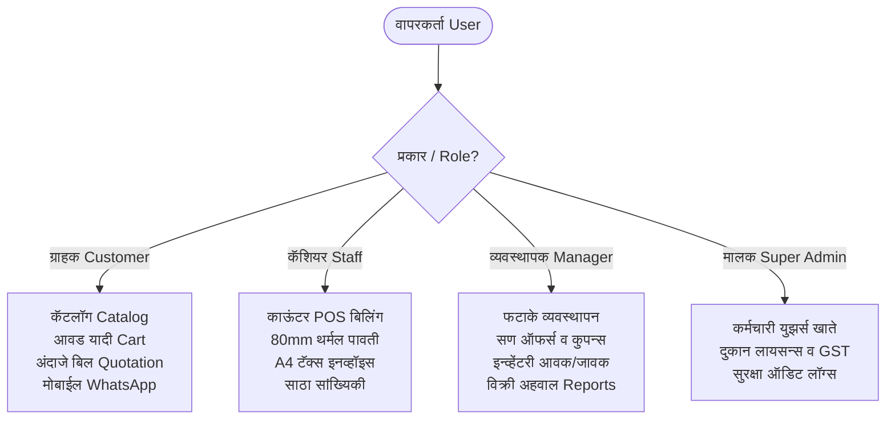

# PRATIK PHATAKE (प्रतीक फटाके)
### 🎆 अधिकृत व परवानाधारक फटाके दालन व्यवस्थापन आणि POS बिलिंग सॉफ्टवेअर
### Licensed Fireworks Retail Management, Customer Inquiry Cart & In-Store POS Billing Suite

[](https://pratik-phatake.web.app)
[](https://github.com/nayneshrathod/phataka_shops.git)
[](https://angular.dev/)
[](https://tailwindcss.com/)
[](https://firebase.google.com/)
[](https://peso.gov.in/)
[](https://www.neeri.res.in/)

---

## 📖 अनुक्रमणिका / Table of Contents
1. [प्रोजेक्ट काय आहे? (What is this Project?)](#1-प्रोजेक्ट-काय-आहे-what-is-this-project)
2. [हा प्रोजेक्ट का बनवला आहे? (Why was this built? - Business & Legal Purpose)](#2-हा-प्रोजेक्ट-का-बनवला-आहे-why-was-this-built)
3. [मुख्य वैशिष्ट्ये (Key Features)](#3-मुख्य-वैशिष्ट्ये-key-features)
   - [A. ग्राहक पोर्टल व अंदाजे बिल पावती (Customer Portal & Quotation Bill)](#a-ग्राहक-पोर्टल-व-अंदाजे-बिल-पावती)
   - [B. काउंटर POS बिलिंग टर्मिनल (In-Store POS Billing Counter)](#b-काउंटर-pos-बिलिंग-टर्मिनल)
   - [C. कमाल आयटम्स बिल फॉरमॅट्स व प्रिंटिंग (Max Items Bill Sizing & Printing)](#c-कमाल-आयटम्स-बिल-फॉरमॅट्स-व-प्रिंटिंग)
   - [D. थेट मोबाईलवर WhatsApp बिल शेअरिंग (Direct WhatsApp Sharing)](#d-थेट-मोबाईलवर-whatsapp-बिल-शेअरिंग)
   - [E. बहुभाषिक प्रणाली (Marathi, Hindi, English)](#e-बहुभाषिक-प्रणाली-3-languages)
   - [F. रोल-आधारित सुरक्षा आणि 4 रोल लॉगिन (Role-Based Access)](#f-रोल-आधारित-सुरक्षा-आणि-4-रोल-लॉगिन)
4. [वापरलेली तंत्रज्ञाने (Technology Stack)](#4-वापरलेली-तंत्रज्ञाने-technology-stack)
5. [क्लाउड फायरस्टोअर डेटाबेस आणि सीडर (Cloud Firestore DB & Live Data Sync)](#5-क्लाउड-फायरस्टोअर-डेटाबेस-आणि-सीडर-cloud-firestore-db--sync)
6. [प्रोजेक्ट फोल्डर रचना (Architecture & Folder Structure)](#6-प्रोजेक्ट-फोल्डर-रचना-folder-structure)
7. [प्रोजेक्ट कसा चालवायचा? (How to Run Step-by-Step)](#7-प्रोजेक्ट-कसा-चालवायचा-how-to-run)
8. [चाचण्या आणि प्रॉडक्शन बिल्ड (Testing & Production Build)](#8-चाचण्या-आणि-प्रॉडक्शन-बिल्ड-testing--build)
9. [Firebase Hosting वर डिप्लॉयमेंट (Deployment to Firebase)](#9-firebase-hosting-वर-डिप्लॉयमेंट-deployment)
10. [डेमो लॉगिन क्रेडेन्शियल्स (Demo Access Credentials)](#10-डेमो-लॉगिन-क्रेडेन्शियल्स-test-accounts)
11. [दुकान संपर्क व परवाना माहिती (Store Credentials & Location)](#11-दुकान-संपर्क-व-परवाना-माहिती)

---

## 1. प्रोजेक्ट काय आहे? (What is this Project?)

**प्रतीक फटाके (PRATIK PHATAKE)** हा पुणे, महाराष्ट्र येथील अधिकृत व परवानाधारक फटाके किरकोळ विक्री दालनासाठी विकसित केलेला एक आधुनिक, हाय-परफॉर्मन्स, रिस्पॉन्सिव्ह आणि क्लाउड-इंटिग्रेटेड वेब ॲप्लिकेशन व POS बिलिंग प्लॅटफॉर्म आहे.

हे ॲप्लिकेशन दोन प्रमुख कार्यप्रणालींमध्ये (Dual Workflows) विभागले आहे:
1. **पब्लिक ग्राहक प्लॅटफॉर्म (Public Customer Website & Inquiry Cart)**:
   - ग्राहक दुकानातील सर्व फटाक्यांचा कॅटलॉग, CSIR-NEERI हरित फटाके प्रमाणीकरण, ध्वनी/प्रकाश तपशील आणि अंदाजे दर पाहू शकतात.
   - फटाके निवडून **आवड यादी / अंदाजे कोटेशन बिल पावती (Estimate Quotation Bill)** तयार करू शकतात.
   - ही पावती PDF डाऊनलोड, PNG इमेज, प्रिंट किंवा थेट स्वतःच्या WhatsApp वर शेअर करू शकतात.
2. **दुकान व्यवस्थापक व कॅशियर POS सिस्टीम (Authorized Store POS & Admin ERP)**:
   - दुकानातील काऊंटरवर जलद **POS बिलिंग (Counter Billing)**.
   - बारकोड स्कॅनिंग, आयटम-निहाय सवलती, सण कॉम्बो ऑफर्स, GST कर विभागणी (CGST + SGST).
   - A4 टॅक्स इनव्हॉइस, 80mm थर्मल रोल पावती व व्हॉट्सॲप कार्ड फॉरमॅट.
   - स्वयंचलित साठा कपात (Atomic Stock Sync), परतावा व रद्द व्यवस्थापन (Returns), ग्राहक माहिती आणि फायनान्शियल अहवाल.

---

## 2. हा प्रोजेक्ट का बनवला आहे? (Why was this built?)

### ⚖️ कायदेशीर व व्यवसायिक पार्श्वभूमी (Legal & Business Rationale)

1. **ऑनलाईन फटाके विक्री व कुरिअर डिलिव्हरीवर कायदेशीर बंदी**:
   - मा. सर्वोच्च न्यायालय (Supreme Court of India) व PESO (Petroleum and Explosives Safety Organisation) च्या मार्गदर्शक तत्त्वांनुसार फटाक्यांचे ऑनलाइन पेमेंट गोळा करणे, ऑनलाइन विक्री करणे आणि कुरिअरद्वारे घरपोच पोहोचवणे **कायद्याने सक्त गुन्हा** आहे.
   - त्यामुळे हे ॲप्लिकेशन **Digital Catalog & Non-Binding Store Inquiry** मॉडेलवर चालते. ग्राहक ऑनलाईन निवड करतात, अंदाजे पावती तयार करतात, आणि अंतिम खरेदी दुकानात प्रत्यक्ष येऊनच केली जाते.

2. **गर्दीच्या काळात जलद काऊंटर बिलिंग (Diwali Festive Rush POS)**:
   - दिवाळीच्या ५-६ दिवसांत फटाक्यांच्या दुकानावर प्रचंड गर्दी असते. हाताने बिले बनवणे अशक्य होते.
   - यासाठी हे **हाय-स्पीड 3-कॉलम POS टर्मिनल** बनवले आहे, ज्यामध्ये कॅशियर अवघ्या ५ सेकंदात बारकोड स्कॅन करून, अचूक जीएसटी व सवलत लावून बिल बनवू शकतो.

3. **कमाल आयटम्ससाठी योग्य पावती (No Cutoff, No Shrinkage)**:
   - ग्राहक २५ ते ५० फटाक्यांचे प्रकार खरेदी करतात तेव्हा साध्या सॉफ्टवेअरमध्ये बिल चपटे (squash) होते किंवा कट होते. या ॲपमध्ये **Multi-page Canvas Slicing** वापरून ५० आयटम्सचे बिलही अत्यंत स्वच्छपणे अनेक पानांवर प्रिंट व PDF होते.

4. **ग्राहकाच्या मोबाईलवर थेट बिल (Direct Customer WhatsApp Billing)**:
   - कागदी पावती हरवली तरी ग्राहकाच्या मोबाईलवर थेट अधिकृत पावतीचा मेसेज व इमेज पोहोचते, ज्यामुळे विश्वासार्हता वाढते.

---

## 3. मुख्य वैशिष्ट्ये (Key Features)



### A. ग्राहक पोर्टल व अंदाजे बिल पावती
- **मुखपृष्ठ (`/`)**: सण-उत्सव थीम, श्रेणी नेव्हिगेशन, लोकप्रिय फटाके, सुरक्षा मार्गदर्शक आणि दुकानाचा पत्ता/वेळ.
- **फटाके कॅटलॉग (`/products`)**: नाव, SKU, प्रकार, किंमत यानुसार रिअल-टाइम सर्च व फिल्टरिंग.
- **फटाका तपशील (`/products/:slug`)**: उच्च दर्जाचे फोटो, CSIR-NEERI ग्रीन क्रॅकर कोड, आवाज पातळी आणि पॅकिंग तपशील.
- **अंदाजे कोटेशन बिल पावती (`/inquiry-cart`)**:
  - निवडून ठेवलेल्या फटाक्यांचे अधिकृत **अंदाजे बिल (Estimate Bill)**.
  - PESO लायसन्स, GSTIN, दुकानाचा पत्ता, ग्राहकाचे नाव, फोन व परिसर.
  - 🖨️ **प्रिंट करा**: डायरेक्ट हार्डवेअर प्रिंटर डायलॉग.
  - 📥 **PDF डाऊनलोड**: मल्टि-पेज हाय-क्वालिटी वेक्टर PDF.
  - 🖼️ **PNG इमेज**: स्पष्ट इमेज फाईल सेव्ह.
  - 📱 **थेट मोबाईलवर पाठवा**: ग्राहकाने टाकलेल्या नंबरवर थेट WhatsApp मेसेज.

### B. काउंटर POS बिलिंग टर्मिनल (`/admin/billing`)
- **3-कॉलम आधुनिक POS लेआउट**:
  - डावीकडे: कॅटलॉग, कॅटेगरी फिल्टर्स व जलद सर्च.
  - मध्यभागी: चालू बिलिंग कार्ट, नग बदलणे, प्रति-आयटम सवलत व हटवणे.
  - उजवीकडे: बिल सारांश, ग्राहक तपशील, पेमेंट पद्धत (रोख / UPI / कार्ड / उधारी), एकूण जीएसटी विभागणी आणि पावती निर्मिती.
- **सवलत आणि ऑफर्स इंजिन**:
  - आयटम-निहाय सवलत (₹ किंवा %).
  - बिल-पातळी सवलत आणि सण कूपन कोड्स.
  - ग्राहकाची एकूण बचत (Customer Savings) हायलाइट.
- **अचूक आर्थिक हिशोब**:
  - राउंड-ऑफ ॲडजस्टमेंट (Round-off adjustment).
  - मिळालेली रोख रक्कम टाकल्यावर परत द्यायची सुट्टी रक्कम (Tendered Change) आपोआप कॅल्क्युलेट होते.

### C. कमाल आयटम्स बिल फॉरमॅट्स व प्रिंटिंग
- **📄 A4 इनव्हॉइस**: १ ते ५०+ उत्पादने असल्यास बिल चेपले जात नाही. प्रत्येक पानात हेडर रिपीट होते (`thead`) आणि खाली पान क्रमांक (`पान १ / २`) येतो.
- **🧾 थर्मल रोल (80mm)**: काऊंटरवरील थर्मल प्रिंटरसाठी सलग रोल (Continuous Roll PDF) जेणेकरून कागदाचा अपव्यय टळतो.
- **📱 व्हॉट्सॲप कार्ड**: आधुनिक डार्क/व्हायलेट फेस्टिव्ह कार्ड, ज्यामध्ये सर्व खरेदी केलेले आयटम्स पूर्ण दिसतात.

### D. थेट मोबाईलवर WhatsApp बिल शेअरिंग
- बिलामध्ये ग्राहक जो मोबाईल नंबर टाकेल, त्यावर **`https://wa.me/91XXXXXXXXXX?text=...`** द्वारे थेट WhatsApp चॅट उघडते.
- पावतीचा मजकूर (तपशील, दर, एकूण, बचत, सुरक्षा नियम) स्वयंचलितपणे टाईप होतो.
- सोबतच पावतीची **PNG इमेज पार्श्वभूमीत डाऊनलोड** होते, जेणेकरून ती WhatsApp मध्ये एका सेकंदात अटॅच करता येते.

### E. बहुभाषिक प्रणाली (3 Languages)
- **मराठी (Default)**, **हिंदी (Hindi)** आणि **English** मध्ये संपूर्ण ॲप रिअ‍ॅक्टिव्ह सिग्नल्सद्वारे क्षणात बदलते.
- नेव्हबार, कॅटलॉग, ॲडमिन डॅशबोर्ड, लॉगिन आणि WhatsApp बिलाचा मेसेजही निवडलेल्या भाषेत जनरेट होतो.

### F. रोल-आधारित सुरक्षा आणि 4 रोल लॉगिन (`/login`)
- **Super Admin (मुख्य व्यवस्थापक)**: संपूर्ण दुकानावर नियंत्रण, स्टाफ युझर्स निर्मिती, GST व लायसन्स सेटिंग्ज.
- **Admin / Manager (स्टोअर मॅनेजर)**: उत्पादने जोडणे/बदलणे, इन्व्हेंटरी आवक-जावक, सण ऑफर्स, अहवाल.
- **Staff / Cashier (काऊंटर कॅशियर)**: केवळ POS काऊंटर बिलिंग, बिल इतिहास, परतावा (Returns).
- **Customer (नोंदणीकृत ग्राहक)**: कॅटलॉग, आवड यादी, अंदाजे कोटेशन बिल.

---

## 4. वापरलेली तंत्रज्ञाने (Technology Stack)

| घटक / Layer | तंत्रज्ञान / Library | व्हर्जन | वैशिष्ट्ये |
|---|---|---|---|
| **Frontend Framework** | Angular | `22.2.2` | Standalone Components, Angular Signals, OnPush Detection, Typed Reactive Forms |
| **Styling & Design** | Tailwind CSS & SCSS | `4.3.3` | Tailwind v4 PostCSS, `@theme` Design Tokens, Custom Glassmorphism, Print Styles |
| **Backend & Database** | Firebase & Cloud Firestore | `15.x` | Real-time NoSQL, Security Rules v2, Indexing |
| **Cloud Hosting** | Firebase Hosting | Production | Global CDN, SSL Certificate, SPA Rewrites |
| **PDF Generation** | jsPDF + html2canvas | Latest | Proportional Multi-Page Canvas Slicing, Continuous 80mm Roll |
| **Testing Framework** | Vitest | `5.0.4` | In-memory fast execution, 29 Automated Tests passing |
| **Language Support** | Custom I18n Engine | Native Angular | Reactive signal-driven Marathi, Hindi, English translations |

---

## 5. क्लाउड फायरस्टोअर डेटाबेस आणि सीडर (Cloud Firestore DB & Live Data Sync)

हा प्रोजेक्ट **Google Firebase Cloud Firestore** डेटाबेसशी पूर्णपणे जोडलेला आहे (Live Project: `pratik-phatake`). 

### 🔥 थेट Firestore मध्ये साठवलेले डेटा सेट्स (Live Collections):
1. **`products` (२५ फटाके उत्पादने)**:
   - सर्व प्रकार: फुलबाज्या, भुईचक्र, अनार, फव्वारे, स्काय शॉट्स, कौटुंबिक कॉम्बो बॉक्सेस, CSIR-NEERI अधिकृत हरित फटाके, लहान मुलांचे सुरक्षित फटाके.
   - प्रत्येक उत्पादनामध्ये SKU, Marathi/Hindi/English नावे, MRP, घाऊक दर, स्टॉक संख्या, सुरक्षितता मार्गदर्शक, आवाज पातळी आणि CSIR-NEERI ग्रीन क्यूआर कोड साठवला आहे.
2. **`categories` (८ प्रमुख श्रेण्या)**:
   - फुलबाज्या, भुईचक्र, अनार, रंगीबेरंगी कारंजे, स्काय शॉट्स, कौटुंबिक कॉम्बो, हरित फटाके, फॅन्सी फटाके.
3. **`banners` (सण उत्सव बॅनर)**:
   - भव्य दीपोत्सव महोत्सव २०२६ आणि पर्यावरणपूरक हरित फटाके दालन बॅनर.
4. **`offers` (सण सवलती व कूपन्स)**:
   - `DIWALI10`: ₹३,००० वर १०% सवलत.
   - `FAMILY500`: ₹५,००० वर थेट ₹५०० रोख सवलत.
   - `SKYSHOT15`: स्काय शॉट्सवर १५% विशेष सवलत.
   - `VIPPHATAKE`: ₹१०,००० वर २०% भव्य कूपन.
5. **`settings/store` (दुकान माहिती व परवाना)**:
   - दुकानाचे नाव, पत्ता, PESO परवाना क्र (`PESO-PUN-RET-2024/7890`), GSTIN, अधिकृत सर्वोच्च न्यायालय सूचना.
6. **`inquiries` (ग्राहक चौकशी नोंदी)**.
7. **`inventoryMovements` (साठा आवक-जावक व नुकसान ऑडिट नोंदी)**.
8. **`users` (सुपर ॲडमिन, व्यवस्थापक, काऊंटर स्टाफ आणि ग्राहक खाती)**.

### ⚡ डेटाबेस सीडिंग कमांड (One-Click Firestore Seeder):
सर्व डेटा एका क्लिकवर क्लाउड फायरस्टोअरमध्ये भरण्यासाठी:
```powershell
npm run seed
# किंवा
node scripts/seed-firestore-complete.js
```
**निकालाचा नमुना:**
```text
=============================================================
PRATIK PHATAKE (प्रतीक फटाके) — Firestore Database Seeder
Connecting to Cloud Firestore project: pratik-phatake
=============================================================
   Products in Firestore:            25
   Categories in Firestore:          8
   Banners in Firestore:             2
   Offers in Firestore:              4
   Inquiries in Firestore:           3
   Inventory Movements in Firestore: 4
   Users in Firestore:               4
=============================================================
ALL FIREBASE FIRESTORE DATA SUCCESSFULLY STORED & LIVE!
```

### 🔄 दुहेरी सिंक्रोनायझेशन (Bidirectional Sync):
- जेव्हा ग्राहक किंवा ॲडमिन ॲप उघडतो, तेव्हा ॲप आपोआप Firestore मधून ताजी उत्पादने, कॅटेगरी व बॅनर लोड करतो (`syncFromFirebaseIfConfigured`).
- ॲडमिन पॅनेलमध्ये नवीन फटाका, कॅटेगरी, ऑफर किंवा दुकान सेटिंग्ज बदलल्यास ते थेट Cloud Firestore मध्ये रिअल-टाइम सेव्ह होतात.
- ऑफलाईन किंवा नेटवर्क अडथळा असल्यास ॲप्लिकेशन स्वयंचलित सुरक्षित LocalStorage Fallback कॅशेवर अविरत चालते.

---

## 6. प्रोजेक्ट फोल्डर रचना (Folder Structure)

```text
d:\Hotel\
├── src\
│   ├── app\
│   │   ├── core\                      # कोअर मॉडेल्स, सर्व्हिसेस, गार्ड्स आणि i18n
│   │   │   ├── guards\                # auth.guard.ts (Role-based route protection)
│   │   │   ├── i18n\                  # translation.service.ts, translations.ts (MR, HI, EN)
│   │   │   ├── models\                # cart.model.ts, invoice.model.ts, discount.model.ts
│   │   │   └── services\              # pos-cart, invoice, bill-export, whatsapp-share, audit
│   │   ├── features\                  # फिचर मॉड्यूल्स (Lazy-loaded standalone)
│   │   │   ├── home\                  # लँडिंग पेज
│   │   │   ├── catalog\               # फटाके कॅटलॉग व फिल्टर्स
│   │   │   ├── product-detail\        # फटाका तपशील व स्पेसिफिकेशन्स
│   │   │   ├── inquiry-cart\          # ग्राहक आवड यादी व अंदाजे बिल कोटेशन मोडल
│   │   │   ├── admin\                 # ॲडमिन व काऊंटर सूट
│   │   │   │   ├── billing\           # POS काऊंटर बिलिंग, इनव्हॉइस प्रिव्ह्यू, परतावा, इतिहास
│   │   │   │   ├── dashboard\         # विक्री व इन्व्हेंटरी केपीआय डॅशबोर्ड
│   │   │   │   ├── inventory\         # साठा व्यवस्थापन व मूव्हमेंट ऑडिट
│   │   │   │   ├── products\          # फटाके जोडणे / बदलणे (CRUD)
│   │   │   │   ├── reports\           # व्हॅल्युएशन व विक्री अहवाल
│   │   │   │   └── login\             # युनिफाईड 4-रोल लॉगिन पोर्टल
│   │   ├── layouts\                   # ॲडमिन लेआउट व पब्लिक लेआउट
│   │   └── shared\                    # हेडर्स, फूटर्स, प्रॉडक्ट कार्ड, टोस्ट नोटिफिकेशन्स
│   ├── environments\                  # environment.ts व environment.prod.ts (Firebase Config)
│   ├── styles.scss                    # ग्लोबल स्टाईल्स आणि @media print मल्टि-पेज नियम
│   └── index.html                     # रूट एचटीएमएल (SEO, Mukta & Poppins फॉन्ट्स)
├── firebase.json                      # Firebase Hosting आणि Firestore डिप्लॉयमेंट नियम
├── firestore.rules                    # क्लाउड फायरस्टोअर सुरक्षितता नियम
├── storage.rules                      # फायरबेस स्टोरेज सुरक्षितता नियम
├── angular.json                       # ॲंगुलर २२ बिल्ड कॉन्फिगरेशन
├── package.json                       # प्रोजेक्ट अवलंबित्व (Dependencies)
└── README.md                          # प्रकल्प माहिती व मार्गदर्शक पुस्तिका
```

---

## 7. प्रोजेक्ट कसा चालवायचा? (How to Run Step-by-Step)

### आवश्यक आज्ञावली (Prerequisites)
- **Node.js**: व्हर्जन `20.x` किंवा `22.x`
- **npm**: व्हर्जन `10.x` किंवा `11.x`
- **Git**

### स्टेप १: प्रोजेक्ट डिरेक्टरीमध्ये जा (Navigate)
```powershell
cd d:\Hotel
```

### स्टेप २: लायब्ररी इन्स्टॉल करा (Install Dependencies)
```powershell
npm install
```

### स्टेप ३: डेटाबेस सिंक/सीड करा (Seed Cloud Firestore Data)
```powershell
npm run seed
```

### स्टेप ४: डेव्हलपमेंट सर्व्हर सुरू करा (Start Development Server)
```powershell
npm start
# किंवा
ng serve
```

### स्टेप ५: ब्राउझरमध्ये उघडा (Open in Browser)
ब्राउझर उघडा आणि खालील पत्त्यावर जा:
👉 **`http://localhost:4200`**

---

## 8. चाचण्या आणि प्रॉडक्शन बिल्ड (Testing & Build)

### स्वयंचलित युनिट चाचण्या चालवणे (Run Unit Tests)
सर्व २९ युनिट चाचण्या चालवण्यासाठी खालील कमांड द्या:
```powershell
npm test -- --watch=false
```
**निकालाचा नमुना:**
```text
Test Files  4 passed (4)
     Tests  29 passed (29)
  Duration  4.04s
```
सर्व चाचण्या वित्तीय हिशोब, टॅक्स कॅल्क्युलेशन, साठा कपात आणि रोल सुरक्षा तपासतात.

### प्रॉडक्शन बिल्ड तयार करणे (Run Production Build)
```powershell
npm run build
```
हे बिल्ड संपूर्ण कोड कॉम्प्रेस करून `dist/pratik-phatake/browser` मध्ये तयार करते.

---

## 9. Firebase Hosting वर डिप्लॉयमेंट (Deployment)

हा प्रोजेक्ट **Firebase Hosting** वर थेट डिप्लॉय केलेला आहे. पुन्हा बिल्ड करून डिप्लॉय करण्यासाठी:

### स्टेप १: फायरबेस लॉगिन करा (जर आधी केले नसेल)
```powershell
firebase login
```

### स्टेप २: प्रोजेक्ट निवडा
```powershell
firebase use pratik-phatake
```

### स्टेप ३: बिल्ड करून थेट Hosting वर डिप्लॉय करा
```powershell
npm run build
firebase deploy --only hosting --project pratik-phatake
```

### स्टेप ४: फायरस्टोअर नियम डिप्लॉय करा
```powershell
firebase deploy --only firestore:rules --project pratik-phatake
```

🌐 **थेट कार्यरत वेबसाईट**: **[https://pratik-phatake.web.app](https://pratik-phatake.web.app)**

---

## 10. डेमो लॉगिन क्रेडेन्शियल्स (Test Accounts)

लॉगिन पेजवर (`/login`) १-क्लिक प्रिसेट बटणे दिलेली आहेत. तुम्ही खालील क्रेडेन्शियल्स वापरून चाचणी करू शकता:

| रोल (Role) | ईमेल (Email) | पासवर्ड | अधिकार (Permissions) |
|---|---|---|---|
| 👑 **Super Admin** | `superadmin@pratikphatake.com` | `admin123` | दुकानावर १००% नियंत्रण, कर्मचारी खाती, GST व परवाना सेटिंग्ज |
| 👔 **Store Manager** | `admin@pratikphatake.com` | `admin123` | उत्पादने बदलणे, इन्व्हेंटरी आवक-जावक, सण ऑफर्स, अहवाल |
| ⚡ **Billing Staff** | `staff@pratikphatake.com` | `admin123` | काऊंटर POS बिलिंग, थर्मल पावती, परतावा आणि चौकशी तपासणी |
| 🛍️ **Registered Customer** | `customer@pratikphatake.com` | `admin123` | कॅटलॉग, आवड यादी, अंदाजे कोटेशन पावती आणि WhatsApp |

---

## 11. दुकान संपर्क व परवाना माहिती

**प्रतीक फटाके (PRATIK PHATAKE)**  
दुकान क्र. १२, फटाके गल्ली, लक्ष्मी रोड, पुणे, महाराष्ट्र ४११०३०  
- **PESO परवाना क्र:** `PESO-PUN-RET-2024/7890`  
- **GSTIN:** `27ABCDE1234F1Z5`  
- **फोन:** +९१ ९८२२० १२३४५  
- **WhatsApp:** +९१ ९८२२० १२३४५  
- **ईमेल:** `contact@pratikphatake.com`  
- **वेळ:** सकाळी ९:०० ते रात्री १०:०० (सणासुदीच्या काळात सर्व दिवस चालू)  

---
*Developed with pride for Pratik Phatake, Pune. Designed for high-speed retail operations & statutory safety compliance.*